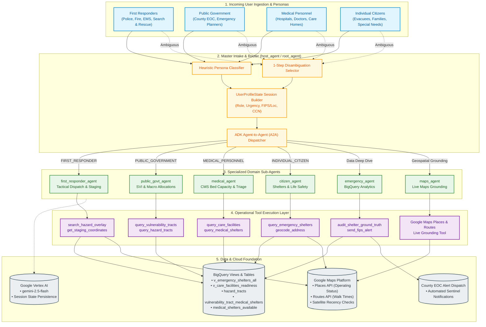
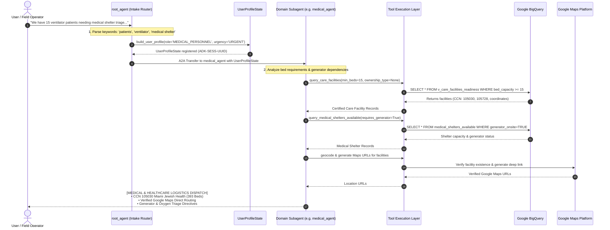

# Multi-Agent Emergency Evacuation & Readiness Architecture

This document describes the high-level system architecture, multi-agent coordination protocol, and end-to-end data flow of the **Google ADK Emergency Evacuation Framework**.

---

## 1. High-Level System Architecture Diagram

---

## 2. End-to-End Request Flow (Sequence Diagram)

---

## 3. Persona Routing & Operational Capabilities

| Persona Role | Target Audience | Trigger Heuristics | Assigned Sub-Agent | Primary Tools | Structured Output Contract |
| :--- | :--- | :--- | :--- | :--- | :--- |
| **`FIRST_RESPONDER`** | Firefighters, Police, EMS, Search & Rescue | *"fire"*, *"EMS"*, *"rescue"*, *"unit"*, *"staging"*, *"tactical"* | `first_responder_agent` | `search_hazard_overlay` `get_staging_coordinates` | `[FIRST RESPONDER TACTICAL DISPATCH]` • Hazard overlay • Staging coords & radio channel • Action items |
| **`PUBLIC_GOVERNMENT_SYSTEMS`** | County EOC, Emergency Managers, Public Safety Admins | *"county"*, *"parish"*, *"FIPS"*, *"SVI"*, *"census tract"*, *"macro"* | `public_govt_agent` | `query_vulnerability_tracts` `query_hazard_tracts` | `[CIVIL INFRASTRUCTURE & VULNERABILITY REPORT]` • County SVI Score • Carless household % • Power dependency count • Generator directives |
| **`MEDICAL_PERSONNEL`** | Hospital Incident Command, Doctors, Triage Nurses, Care Directors | *"CCN"*, *"hospital"*, *"patient"*, *"nurse"*, *"certified bed"*, *"triage"* | `medical_agent` | `query_care_facilities` `query_medical_shelters_available` `query_vulnerability_medical_shelters` | `[MEDICAL & HEALTHCARE LOGISTICS DISPATCH]` • Provider CCN & Beds • Generator & Oxygen status • Safe transfer routing |
| **`INDIVIDUAL_CITIZEN`** | General Public, Evacuees, Families, Pet owners, Mobility impaired | *"shelter"*, *"evacuate"*, *"family"*, *"pet"*, *"wheelchair"*, *"where to go"* | `citizen_agent` | `query_emergency_shelters` `geocode_address` `verify_shelter_on_google_maps` | `[CITIZEN EVACUATION ASSISTANCE]` • Open shelters outside flood zones • ADA & Pet policies • Direct Google Maps links |
| **`CORE_DATA_ANALYTICS`** | Deep spatial queries & cross-table SQL operations | *"BigQuery"*, *"custom SQL"*, *"vulnerability distance"* | `emergency_agent` | `execute_custom_bigquery` `query_emergency_shelters` | Structured Table Data & Spatial Calculations |
| **`CORE_GEOSPATIAL`** | Live ground truth & place verification | *"grounding"*, *"is building open"*, *"Google Maps status"* | `maps_agent` | `google_maps_grounding` `verify_shelter_on_google_maps` | Real-time Places & Routes Verification |

---

## 4. Safety & Grounding Guardrails

1. **Life Safety First (Floodplain & Storm Surge Exclusion):**
   * Before recommending any shelter to citizens or first responders, the system inspects `in_100_yr_floodplain` and `in_surge_slosh_area`.
   * Shelters located in active flood zones are disqualified and flagged as hazardous.

2. **The "Skeptic" Sentinel Protocol (Ground-Truth Auditing):**
   * Federal records (e.g., FEMA historical entries) indicating `is_functional = TRUE` are never accepted blindly.
   * Facilities are cross-referenced with live Google Maps signals. If Google Maps reports `CLOSED_PERMANENTLY` or demolished, the federal record is immediately overridden.

3. **Last-Mile Transit Equity:**
   * Distances for carless populations (where `pct_no_vehicle > 20%`) are evaluated using pedestrian walking durations rather than straight-line Euclidean vectors.
   * Walks exceeding 20 minutes or traversing flood barriers trigger critical transit warnings.

4. **External Intervention Dispatches:**
   * When a critical medical shelter fails ground truth verification, the system invokes `send_fips_alert` to notify the designated county Emergency Operations Center (EOC).
